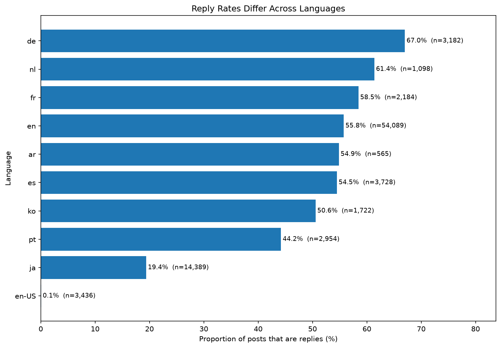

# Data Project 3: Bluesky Message reply distribution by language

**Author:** Shreya Karumuri
**DS 3022 Data Project 3, Fall 2026**

## Data source

This project uses Bluesky Jetstream, a public, real-time WebSocket stream of Bluesky events

- Source: Bluesky Jetstream
- Stream URL: wss://jetstream2.us-east.bsky.network/subscribe?wantedCollections=app.bsky.feed.post
- Method: Push. Jetstream continuously sends new post events over a WebSocket connection.
- What a message contains: A JSON envelope with fields such as did, time_us, kind, and commit. For post events, commit contains fields such as operation, collection, rkey, and record; the record can contain the post text and language.
- Authentication: No account, API key, or custom User-Agent is required for this public Jetstream subscription.
- Kafka topic: bluesky_messages. Your producer forwards the original JSON messages to Redpanda.

The project collects live events rather than replaying a historical archive.

## How to run


The following instructions assume a fresh clone of the repository and Docker Desktop installed and running. The commands are run from its root directory unless otherwise specified. Open five terminals (T1–T5).

```


### 1. Set up the Python environment (T1)

From the repository root, create and activate the virtual environment, then install the dependencies:

```bash
python3 -m venv .venv
source .venv/bin/activate
pip install -r requirements.txt
python -c "import quixstreams, duckdb, prefect, matplotlib; print('ok')"
```

### 2. Start the Redpanda cluster (T4)

From the repository root:

```bash
docker compose up -d
docker exec -it redpanda-0 rpk cluster info
```

The cluster runs three Redpanda brokers and Redpanda Console. The Console is available at http://localhost:8080.

### 3. Create the Kafka topic (T1)

From the repository root:

```bash
docker exec redpanda-0 rpk topic create bluesky_messages -p 3 -r 3
```

### 4. Run the producer (T1)

Enter the `project3` directory and start the producer:

```bash
cd project3
python producer.py
```

Leave the producer running while collecting data.

### 5. Run the lander (T2)

From the repository root, activate the virtual environment and enter `project3`:

```bash
source .venv/bin/activate
cd project3
python lander.py
```

The lander consumes messages from `bluesky_messages` and writes Parquet batches to `data/raw/`. Once sufficient data has been collected, stop the producer first. Allow the lander to finish writing its remaining batch before stopping it.

### 6. Start the Prefect server (T5)

From the repository root:

```bash
source .venv/bin/activate
cd project3
prefect config set PREFECT_API_URL=http://127.0.0.1:4200/api
prefect server start
```

The Prefect dashboard is available at http://127.0.0.1:4200. Leave the server running while executing the pipeline.

### 7. Run the pipeline on the full dataset (T3)

From the repository root:

```bash
source .venv/bin/activate
cd project3
python flow.py
```

This processes the Parquet files in `data/raw/` and generates `charts/reply_percentage_by_language.png`. Run the flow twice to verify that both runs produce the same four numbers.

### 8. Run the pipeline on the sample dataset (T3)

From the `project3` directory:

```bash
python kit/make_sample.py
python flow.py data/sample
```

This processes the committed sample Parquet files and generates `charts/reply_percentage_by_language_sample.png`. Run the sample flow twice to verify that both runs produce the same four numbers.

## Architecture


## Design decisions

1. **Key and partitions.** 
The producer uses the account's DID (decentralized identifier) as the Kafka message key. This groups events from the same Bluesky account into the same partition, preserving their order within that partition. Using a different key, such as the post's rkey, could distribute events from the same account across different partitions, making it harder to preserve account-level ordering. 
2. **Batch size and time.** 
The lander writes a batch when it reaches 1,000 records or when 60 seconds have passed, whichever happens first. The measured rate is 67.97 per second. The lander reaches the 1,000-record threshold in approximately 14.7 seconds. Therefore, the record-count limit closes most batches, producing approximately 245 Parquet files per hour if the ingestion rate remains consistent.
3. **Offsets after the file.**
The lander writes each batch to a temporary Parquet file and renames it to its final filename before storing the Kafka offsets. If the lander crashes after writing the file but before storing the offsets, Kafka can deliver those messages again when the lander restarts. This results in duplicate records rather than lost records. I accept this at-least-once approach because duplicates can be identified and removed during staging, whereas lost messages cannot be recovered from the landed files.
4. **Duplicates.**
Two records are considered the same Kafka record if they have the same partition and offset. The staging task removes duplicate landed records using SELECT DISTINCT * EXCLUDE (landed_at) which removes duplicate rows that differ only in landing time. Two records represent the same Bluesky post if they share the same DID and rkey. The entities task removes these duplicates using QUALIFY ROW_NUMBER() OVER (PARTITION BY did, rkey ORDER BY time_us DESC, kafka_offset DESC) = 1, keeping the latest operation for each post. This also accounts for posts that are created and later deleted.


5. **Windows and time.** 
My analysis compares reply percentages across language categories rather than examining trends over time. Although I convert time_us into a UTC event timestamp, I do not use it as a time window because my research question focuses on differences between languages.
6. **Ten times the volume.**
At ten times the current volume, the staging and entities tasks would likely become slower because they reread the raw Parquet files and perform duplicate removal and window-based deduplication across a much larger dataset. The single lander process could also become a bottleneck as message volume increases. I would first monitor ingestion and query performance, then increase Kafka partitions and scale consumers if ingestion becomes constrained. For processing, I would consider incremental transformations so that each run processes new records instead of rebuilding the entire database from all raw files.
## Chaos round

| Card | Prediction | What I did | Numbers before → after | Explanation |
|---|---|---|---|---|
| D1 Crash between file and offsets | The same Kafka messages will be landed again after restarting the lander, creating duplicate records in Parquet. | Crashed the lander after writing a Parquet file but before storing offsets, then restarted it. Stopped the lander, ran python producer.py, stopped it then ran, python lander.py crash, python lander.py, waited for the last batch, counted | Raw: 103,951 → 449,853; malformed: 194 → 582; unique Kafka records: 103,757 → 103,757; unique Bluesky posts: 101,150 → 101,150| Because offsets were not stored, Kafka redelivered the messages. The raw record count increased, but deduplication kept the unique Kafka count unchanged. |
| D2 Poison message | The lander keeps running and does not crash. Malformed goes from 0 to 1. | rpk topic produce bluesky_messages -k bad, typed text, waited for the next file, counted | Raw: 449,853 → 449,855; malformed: 582 → 584; unique Kafka records: 103,757 → 103,757; unique Bluesky posts: 101,150 → 101,150| to_row() caught the JSON error and landed the text as malformed, so the lander did not crash and the partition was not blocked.. |
| D3 Broker Down | The cluster will continue accepting and processing messages while one broker is down. Duplication will  | Producer and lander running; docker stop redpanda-1 for 60 s. docker start redpanda-1, waited for Running; stopped the producer, waited 60 s, counted | Raw: 449,855 → 463,116; malformed: 584 → 584; unique Kafka records: 103,757 → 117,018; unique Bluesky posts: 101,150 → 114,072| Stopping one broker reduced the cluster from three available brokers to two and caused under-replicated partitions. The topic's replicas on the remaining brokers allowed production and consumption to continue. When the stopped broker returned, replication could recover. Raw records and unique records increased by the same with no additional malformed messages or duplicate Kafka records.  |

## The four numbers

From the flow log on the full data (screenshot in `docs/`):

| Number | Full data | Sample (`data/sample`) |
|---|---:|---:|
| Raw records landed | 463,116 | 5,000 |
| Malformed (kept in raw) | 584 | 6 |
| Unique Kafka records | 115,572 | 4,828 |
| Unique Bluesky posts (did, rkey) | 114,072 | 4,825 |

## Challenges / Obstacles

The source was challenging to gather because Bluesky produces messages so rapidly that it was easy to collect a large volume of data in a short amount of time. I managed this by setting a timer and monitoring the collection period. Processing and analyzing the data was also challenging because the source is primarily text-based, meaning very little information is pre-extracted beyond fields such as language. This limited the analysis I could perform without additional text processing. Rather than attempting to interpret the content of individual posts, I chose to analyze language alongside the type of action, specifically whether a post was a reply or an original post. Using Python, DuckDB, SQL, and Prefect, I cleaned and deduplicated the records, extracted the reply information from the raw JSON data, and compared reply percentages across languages. This allowed me to develop a meaningful comparison using the structured information available in the source.
## Analysis

My research question examines how the percentage of posts that are replies varies across languages on Bluesky. The data shows that the proportion of replies differs across language groups, suggesting that users may engage with posts differently depending on the language community. I was surprised that English did not have the highest percentage of replies. I initially expected English-language posts to have a higher reply percentage because of the visible culture of responding to, criticizing, debating, and fact-checking posts in English-speaking online spaces. One limitation of my method is that reply percentage only measures whether a post is a reply, not the nature or quality of the interaction. Additionally, my dataset reflects Bluesky activity collected during a limited period and may not represent the platform's broader user population or language communities.

## Plot / Visualization




Bluesky posts collected in the collection period November 12, 2026, 13:49 UTC – November 16, 2026, 11:54 UTC. through the Kafka streaming pipeline and stored in Parquet files. Each bar represents the percentage of posts in that language classified as replies. Labels show the total number of posts included for each language. The top 10 (highest percentage of replies) are shown and languages with fewer than 100 observations are exluded.

## Reflection

I would approach this project differently by being more deliberate about collecting at least 50,000 records without allowing the source's rapid message flow to become difficult to manage. I would also take more time to understand the purpose and expected outcome of each chaos experiment before executing it. This would help me recognize whether the results make logical sense, and understand the underlying mechanisms. Before this project, I understood that streaming systems could process information continuously, but I did not fully appreciate how quickly they could collect large volumes of live data or how important reliability becomes when handling that volume. I learned how mechanisms such as offsets, at-least-once delivery, replicas, and malformed-message handling affect whether data is lost, duplicated, or successfully processed. Overall, I gained a better understanding of how streaming systems work beyond simply collecting data in real time.

## Acknowledgements

I used the course walkthroughs and class materials to guide the project setup, understand the streaming concepts, and complete the chaos experiments. I also used the provided `probe.py` code as a reference for connecting to the streaming source. I used ChatGPT for assistance with debugging Python and Prefect errors, understanding Kafka and Redpanda behavior, interpreting experiment results, and improving my project documentation. I checked the suggestions by running commands in my own environment, comparing the results against terminal and Prefect logs, and verifying that repeated flow runs produced identical counts. I adapted the code and explanations to match my project's actual implementation and results.